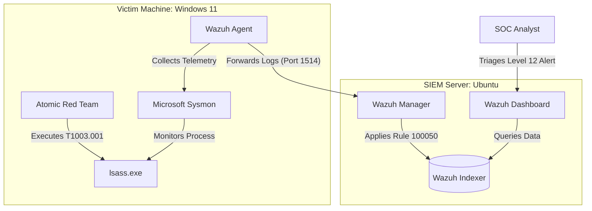
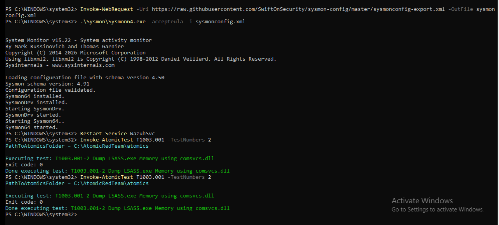
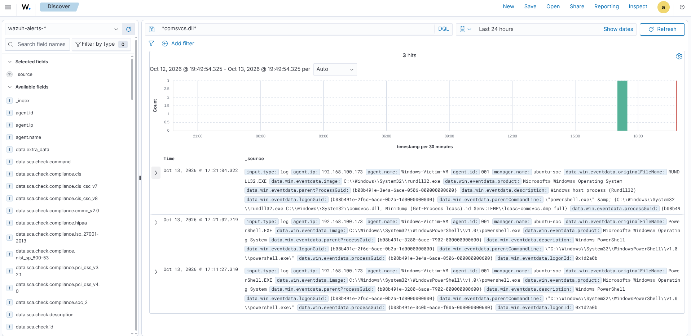
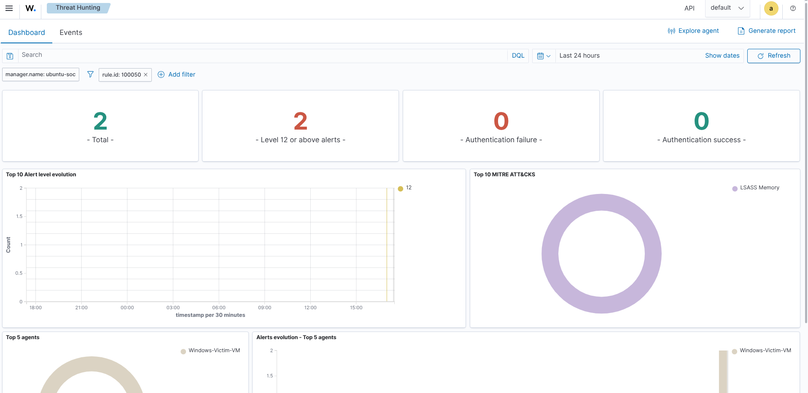

# Full Cycle SIEM & Detection Engineering Lab

## Overview
This project is a local SIEM environment and its role is to configure deep endpoint telemetry, simutale a real world cyber attack, and create custom detection rules to identify malicious activity.

## Tools Used
- **Wazuh SIEM** (Manager, Indexer, Dashboard)
- **Microsoft Sysmon** (SwiftOnSecurity configuration)
- **Atomic Red Team** (Adversary simulation framework)
- **VirtualBox** (Infrastructure hosting)
- **Ubuntu Server** (SIEM Host)
- **Windows 11 Pro** (Victim Endpoint)

---

## Architecture Diagram



---

## How to run
### 1: Deploy the Wazuh SIEM
I set up an Ubuntu Server VM and opened the necessary firewall ports to allow agent communication and dashboard access.

```bash
sudo apt update && sudo apt upgrade -y
sudo ufw allow 433/tcp
sudo ufw allow 1514/tcp
sudo ufw allow 1515/tcp
sudo ufw enable
```

I then installed the full Wazug stack using their automated installation script.

```bash
curl -sO [https://packages.wazuh.com/4.14/wazuh-install.sh](https://packages.wazuh.com/4.14/wazuh-install.sh)
sudo bash wazuh-install.sh -a
```

### 2: Configuring the Windows Agent & Sysmon
On the Windows VM, I installed the Wazuh agent to forward logs to the SIEM via PowerShell

```powershell
Invoke-WebRequest -Uri [https://packages.wazuh.com/4.x/windows/wazuh-agent-4.14.8-1.msi](https://packages.wazuh.com/4.x/windows/wazuh-agent-4.14.8-1.msi) -OutFile wazuh-agent.msi msiexec.exe /i wazuh-agent.msi /q WAZUH_MANAGER="<YOUR_UBUNTU_IP>" WAZUH_REGISTRATION_SERVER="<YOUR_UBUNTU_IP>"
NET START WazuhSvc
```

Because Windows default logging system is insufficient for catching advanced threats, I installed Microsoft Sysmon using the SwiftOnSecurity configuration file.

```powershell
Invoke-WebRequest -Uri [https://download.sysinternals.com/files/Sysmon.zip](https://download.sysinternals.com/files/Sysmon.zip) -OutFile Sysmon.zip
Expand-Archive Sysmon.zip -DestinationPath .\Sysmon -Force

Invoke-WebRequest -Uri [https://raw.githubusercontent.com/SwiftOnSecurity/sysmon-config/master/sysmonconfig-export.xml](https://raw.githubusercontent.com/SwiftOnSecurity/sysmon-config/master/sysmonconfig-export.xml) -OutFile sysmonconfig.xml

.\Sysmon\Sysmon64.exe -accepteula -i sysmonconfig.xml
```

The Wazug agent needs to collect these logs, so we need to append the following block to the agent's `ossec.conf` file and restart the service

```xml
<localfile>
  <location>Microsoft-Windows-Sysmon/Operational</location>
  <log_format>eventchannel</log_format>
</localfile>
```

```powershell
Restart-Service WazuhSvc
```

### 3: Adversary Simulation (MITRE T1003.001)
With the telemetru pipeline active, Windows Defender must be disabled and you need to install **Atomic Red Team** to simulate an attack.

```powershell
Set-ExecutionPolicy Bypass -Scope Process -Force
IEX (IWR '[https://raw.githubusercontent.com/redcanaryco/invoke-atomicredteam/master/install-atomicredteam.ps1](https://raw.githubusercontent.com/redcanaryco/invoke-atomicredteam/master/install-atomicredteam.ps1)' -UseBasicParsing);
Install-AtomicRedTeam -getAtomics -Force
```

I executed **T1003.001 - OS Credential Dumping**. I ran Test #2, which utilizes **comsvcs.dll** to dump the memory of the **lsass.exe** process.

```powershell
Invoke-AtomicTest T1003.001 -TestNumbers 2
```


To ensure the SOC is immediately notified if this attack occurs again, I wrote a custom detection rule in **local_rules.xml** on the Wazuh Manager. This rule triggers a Level 12 alert.

```xml
<group name="sysmon, atomic_red_team,">
  <rule id="100050" level="12">
    <if_group>sysmon_event1</if_group>
    <match>comsvcs.dll</match>
    <description>High Severity: LSASS memory dump attempt using comsvcs.dll (T1003.001)</description>
    <mitre>
      <id>T1003.001</id>
    </mitre>
  </rule>
</group>
```

Apply the rule by restarting the Wazuh Manager

```bash
sudo systemctl restart wazuh-manager
```



